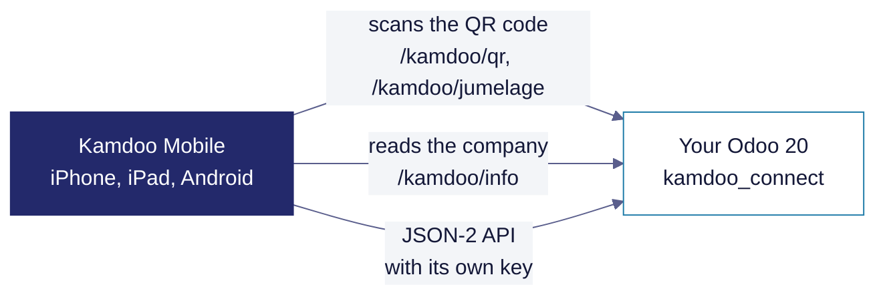

<p align="center">
  <picture>
    <source media="(prefers-color-scheme: dark)" srcset="docs/assets/readme/banniere-kamdoo-odoo-sombre.svg">
    
  </picture>
</p>

**Kamdoo Connect is the free, open-source module for Odoo 20 that pairs Kamdoo Mobile with your database by QR code, shows your company's name, logo and colour in the app, and gives each phone an API key of its own.**

Kamdoo Mobile works without it: people sign in with their usual Odoo login. This module adds what the app cannot do on its own.

## How it works



## What it adds

| Feature | What happens |
| --- | --- |
| **Connect my phone** | In the user menu, a QR code the app scans. It holds a one-time token valid for five minutes, never a login or a password. |
| **Your company in the app** | Its name, logo and colour, read by the app before sign-in from the public route `/kamdoo/info`: what the public login page already shows, nothing more. |
| **Settings** | A **Kamdoo on your phone and tablet** section in Settings, with a link to your QR code. |
| **A key for each phone** | The app talks to the JSON-2 API with an API key of its own instead of a browser session. The key is named after the phone, expires after the duration set in Settings (**Phone key duration**, 30 days by default), is renewed by the app before then, and is revoked like any API key in Preferences › Account Security. |

## Get started

```bash
git clone --branch 20.0 --single-branch https://github.com/kamka-ai/kamdoo-odoo.git
cp -r kamdoo-odoo/kamdoo_connect /path/to/your/addons/
odoo -d <database> -i kamdoo_connect --stop-after-init
```

The module **Kamdoo Mobile Connector** is installed: each user opens the user menu › **Connect my phone** and scans the QR code with Kamdoo Mobile.

## Structure

| Path | What it holds |
| --- | --- |
| `kamdoo_connect/controllers/` | The routes the app calls: `/kamdoo/info`, `/kamdoo/qr`, `/kamdoo/jumelage`, and `/kamdoo/cle` to issue, renew and revoke the phone key |
| `kamdoo_connect/models/` | The one-time pairing token, the phone API key and its duration setting |
| `kamdoo_connect/views/`, `static/` | The QR page, the Settings section, the user-menu entry and touch-friendly styles |
| `kamdoo_connect/i18n/` | Translations |
| `kamdoo_connect/tests/` | The module's tests |

## Supported versions

One branch per Odoo version. Take the branch of your version: each one only holds what that version needs.

| Odoo version | Branch | Status |
| --- | --- | --- |
| 14 | `14.0` | Supported |
| 15 | `15.0` | Supported |
| 16 | `16.0` | Supported |
| 17 | `17.0` | Supported |
| 18 | `18.0` | Supported |
| 19 | `19.0` | Supported |
| 20 | `20.0` | Supported · this branch |

## Privacy and security

- Kamdoo Mobile talks directly to your Odoo: Kamka IT receives none of your data.
- The QR code holds a one-time token valid for five minutes, never a login or a password.
- Each phone has its own API key, with an expiry date; revoking it in Preferences › Account Security disconnects that phone only.
- Report a vulnerability privately through GitHub: the **Security** tab, then **Report a vulnerability**. Never in a public issue.

## Tests

```bash
odoo -d <database> -i kamdoo_connect --test-enable --stop-after-init
```

## Contributing

Open an issue first, then a pull request against the branch of the Odoo version concerned (`20.0` here).

## Learn more

| Document | Where |
| --- | --- |
| Kamdoo | [kamdoo.app](https://kamdoo.app) |
| Privacy policy of Kamdoo Mobile | [kamdoo.app/privacy.html](https://kamdoo.app/privacy.html) |
| Licence | [LGPL-3](LICENSE) |

---

<sub>Kamdoo, by Kamka IT · compatible with Odoo, not affiliated with Odoo S.A. · LGPL-3</sub>
